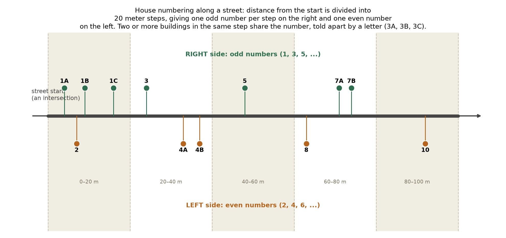
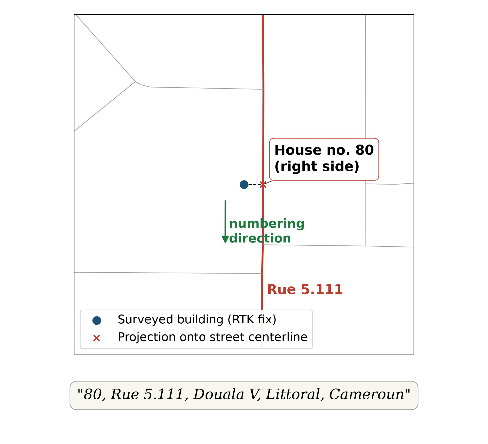

## Why an address system matters

An estimated four billion people worldwide lack a reliable, usable address. This has direct consequences for banking, mail delivery, emergency response, voter registration, and utility connection [1](#ref1). The World Bank's own reference guide on street addressing looks at dozens of implementation cases in African cities. It finds that a working address system is not a mere convenience. It is a precondition for effective municipal tax collection, land management, service provision, and civic identity [2](#ref2). Fotouni and the surveyed blocks of Douala fall clearly into this gap. Buildings exist, streets exist, but no formal, agreed system currently links a specific building to a specific, communicable location description.

The importance of addresses becomes sharper once the digital consequences are considered. A formal address is what lets a building be looked up, routed to, billed, registered, or referenced consistently across independent systems. This includes an online delivery service, a bank's know-your-customer process, a national census, and a digital twin of the town. Without an address, every one of those systems has to invent its own way of referring to a location, usually a coordinate pair meaningless to a resident, or a verbal description that does not scale.

## Existing alternatives

Several alternative digital addressing schemes already exist. What3Words divides the world into three by three meter squares and assigns each one a memorable combination of three dictionary words. This makes any location on Earth referenceable without needing existing street infrastructure. A peer-reviewed analysis of its algorithm found a non-negligible number of confusable, near-identical word triplets assigned to nearby but distinct locations, flagged as a real concern in emergency response [3](#ref3). Google's Open Location Code, or Plus Codes, offers a similar grid scheme using a short alphanumeric code derived openly from latitude and longitude, with no licensing restriction and no dictionary confusability risk [4](#ref4). Both schemes share one property relevant here. They encode an arbitrary point in space, independent of any real street or neighborhood. That makes them universally applicable, but disconnected from how people already describe where they live, by street and house number, not by an abstract code.

## Our approach

This project instead builds an address that looks and functions like a conventional street name and house number system, generated automatically from OpenStreetMap (OSM) data rather than an official cadaster. OSM's street geometry and administrative boundaries are already remarkably complete even without a formal cadastral survey [5](#ref5)[6](#ref6). Where they are incomplete, they can be corrected directly by the same community that will use the resulting addresses, through ordinary OSM editing. Rather than waiting for a government survey, the addressing pipeline, implemented in the `OSMAddressSystem` package, takes whatever street network OSM already has for a town and turns it into a numbering scheme. Gaps found along the way, such as an unnamed street or a missing building, become useful signals fed back into OSM, improving the shared dataset for the next town that runs the same pipeline.

The pipeline runs in four stages: street identity, numbering direction, house numbers and administrative labels, and manual review.

### 1. Street identity assignment

OSM represents a street as separate way segments, split at every intersection even where there is no real reason for the street to change identity there. Segments can carry slightly different name spellings, and a single street can be mapped as two separate one-way carriageways instead of one two-way way. `street_ids.label_streets` assigns one stable `street_id` to each real, contiguous street, so house numbers can be computed along one continuous line rather than restarting at every intersection.

Two rules drive this assignment at every junction. Incident edges are grouped into rank tiers by highway type, and only the dominant tier continues its identity through a crossing. A residential street crossing a primary road is cut there, while the primary road keeps one identity straight through. Within the dominant tier, edges whose tangent directions fall within a threshold angle, 20 degrees by default, are merged. A shared, fuzzy-matched OSM name overrides both rules, since a shared real name is a stronger identity signal than rank or geometry alone. Genuinely parallel edges, such as a divided carriageway or a roundabout arc, are grouped by a separate length-aware geometry check.

 raw OSM input: six way segments meeting at one crossing, colored by highway rank and named or unnamed status. (b) the four resulting street_ids: the primary road keeps one identity straight through, two unnamed residential arms are cut into separate identities at the crossing, and two residential arms sharing the name \"Rue Owendo\" merge into one identity despite crossing the same intersection.")

### 2. Street numbering direction

Once every street has a stable identity, `street_direction.assign_street_directionality` decides which way its numbers should climb, following one of two conventions. Radial numbering, the default, suits towns that grew organically around a center, such as a main square or a chieftaincy, and is the mode used for Fotouni. Each street's endpoints are compared by distance to that center. If the two distances are close, the street runs around the center and is numbered clockwise. Otherwise it runs toward or away from the center and is numbered outward. Grid numbering suits planned, grid-laid-out towns and is the mode used for the more regular core of Douala. Each street is classified as primary or cross depending on whether its bearing is closer to a reference compass direction, autodetected from the network's own dominant bearing, or to its perpendicular. Numbers then climb toward that direction, independent of any center point.

 radial mode: four streets climb outward from the origin (red cross), while a fifth street connecting two tips at equal distance from the origin is correctly classified transversal and climbs clockwise instead. (b) grid mode: avenues climb north, cross streets climb east, independent of any center point.")

### 3. House numbers and administrative labels

Each street's cumulative length from its own numbering start is converted into a house number, following the same even-on-the-right, odd-on-the-left convention used in most postal systems. A base number is the cumulative distance divided by a fixed step, 20 meters by default, then nudged to the nearest number of the required parity. Which side of the street a point falls on is found from the cross product between the street's direction vector and the vector to the point, the same left or right test a driver would apply. Each street is also tagged with its neighbourhood, town, province, and country, resolved by reverse-geocoding the relevant OSM administrative boundary polygons. The result is a formatted address such as "number, street name, neighbourhood, city, province, country", functionally equivalent to a conventional postal address even where none existed before.

### 4. Manual review and correction

Because this pipeline relies on imperfect, community-maintained geographic data, a community setting up its first addressing system, for example Fotouni, first needs to complete and check the local street network in OpenStreetMap. Once the road geometry is good enough, the system can automatically generate street groupings, identify main paths, work out addressing directions, and assign house-numbering sequences. These automated results should still be checked by local users who know the area better than the algorithm.

A browser-based map editor supports this process. It lets community members correct automatically assigned street segments and adjust the proposed street structure, and lets the community assign official street names based on local preference and administrative decisions. Every downstream addressing step is then recomputed from the corrected street membership and naming decisions, rather than relying only on automatic geometric assumptions.

After local review, confirmed street names can be uploaded back into OpenStreetMap through a documented, conservative workflow that follows OSM's own community import guidelines [7](#ref7). Scripted changes use the `osmapi` Python package [8](#ref8), with edits tested first against OSM's public sandbox. This closes the loop between the local addressing system and the open geographic database, so the updated street information becomes part of the shared dataset and gives a reliable foundation for installing physical street signs.

## Pilot applications

The full pipeline has been run end to end in two real Cameroonian towns. In Bandja, the municipality that contains Fotouni, a preliminary radial addressing scheme was generated using the centroid of the mapped settlement polygons as the reference point. Douala contains a substantial grid-based urban core, and two building blocks in the Bonamoussadi neighbourhood were processed with grid addressing instead. The dominant street orientation needed for the grid was not set by hand. It was estimated automatically from the geometry of the surrounding street network. Explore both towns in the interactive map below.

## References

1. Universal Postal Union (2012). Addressing the World, An Address for Everyone. <a class="ref-link" href="https://www.upu.int/UPU/media/upu/publications/whitePaperAddressingTheWorldEn.pdf">https://www.upu.int/UPU/media/upu/publications/whitePaperAddressingTheWorldEn.pdf</a>
2. Farvacque-Vitkovic, C., Godin, L., Leroux, H., Verdet, F., Chavez, R. (2005). *Street Addressing and the Management of Cities*. The World Bank. <a class="ref-link" href="https://doi.org/10.1596/0-8213-5734-3">https://doi.org/10.1596/0-8213-5734-3</a>
3. Arthur, R. (2023). A Critical Analysis of the What3Words Geocoding Algorithm. PLOS ONE, 18(10), e0292491. <a class="ref-link" href="https://doi.org/10.1371/journal.pone.0292491">https://doi.org/10.1371/journal.pone.0292491</a>
4. Google (2024). Open Location Code (Plus Codes) Specification. <a class="ref-link" href="https://github.com/google/open-location-code">https://github.com/google/open-location-code</a>
5. Yeboah, G., Porto de Albuquerque, J., Troilo, R., Tregonning, G., et al. (2021). Analysis of OpenStreetMap Data Quality at Different Stages of a Participatory Mapping Process: Evidence from Slums in Africa and Asia. ISPRS International Journal of Geo-Information, 10(4), 265. <a class="ref-link" href="https://doi.org/10.3390/ijgi10040265">https://doi.org/10.3390/ijgi10040265</a>
6. Barrington-Leigh, C., Millard-Ball, A. (2017). The world's user-generated road map is more than 80% complete. PLOS ONE, 12(8), e0180698. <a class="ref-link" href="https://doi.org/10.1371/journal.pone.0180698">https://doi.org/10.1371/journal.pone.0180698</a>
7. OpenStreetMap Wiki (2024). Import/Guidelines. <a class="ref-link" href="https://wiki.openstreetmap.org/wiki/Import/Guidelines">https://wiki.openstreetmap.org/wiki/Import/Guidelines</a>
8. osmapi (2024). osmapi: A Python Wrapper for the OSM API. <a class="ref-link" href="https://osmapi.metaodi.ch/">https://osmapi.metaodi.ch/</a>
