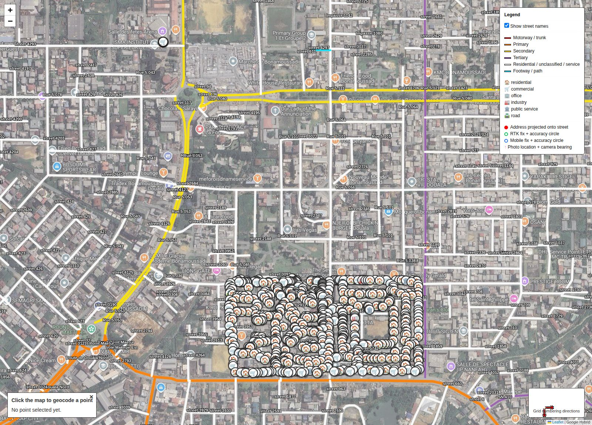
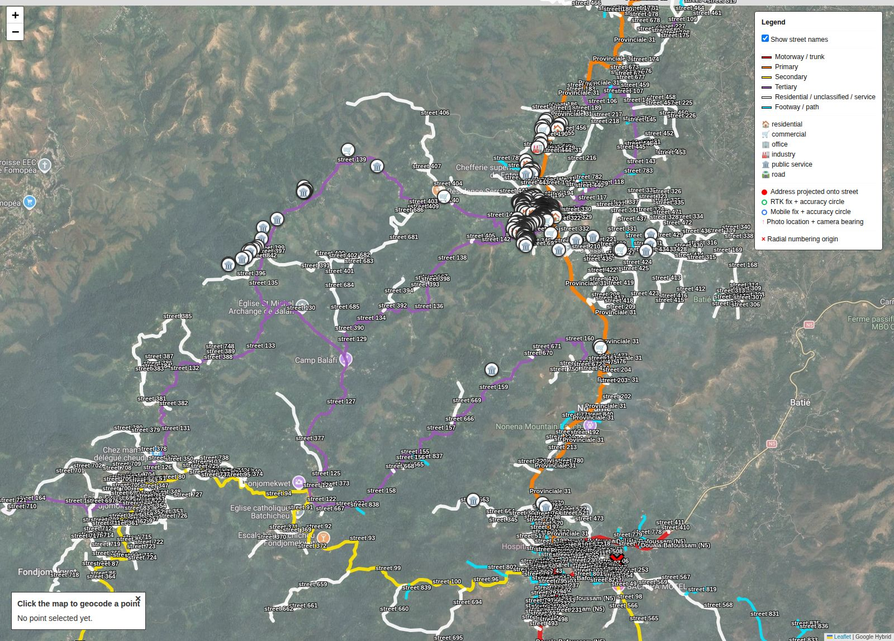

## Why survey buildings at all

An estimated four billion people worldwide lack a reliable, usable address, with direct consequences for banking, mail delivery, emergency response, voter registration, and utility connection [1](#ref1). Every other pipeline on this site, including the [addressing system](../addressing-system/index.html) and the [proximity analysis](../proximity/index.html), runs on the same underlying input. That input is a building-level survey pairing each real building with an accurate location, a land use classification, and, where available, a photo. This page describes that initial survey data and the plan to extend it into a full community-driven census for the town of Fotouni.

## Initial survey data

Two pilot datasets were collected in the field, one in surveyed blocks of Bonamoussadi in Douala, the other around the town center and chieftaincies of Fotouni. Each row records a paired RTK-rover and mobile-phone GPS fix for the same physical point, together with a land use classification and, for a subset of Fotouni points, a geotagged photo and bearing.

| | Bonamoussadi, Douala | Fotouni |
|---|---|---|
| Survey dates | March 20 to 21, 2026 | March 24 to 25, 2026 |
| Points surveyed | 717 | 358 |
| RTK precision (median / mean) | 0.02 m / 0.15 m | 0.11 m / 0.17 m |
| Mobile precision (median / mean) | 1.70 m / 2.33 m | 3.79 m / 4.01 m |
| Mobile position error vs. RTK (median / mean) | 4.06 m / 4.62 m | 5.13 m / 6.32 m |
| Coverage | Two contiguous urban blocks | Town center and the third-level chieftaincies |

Comparing the paired RTK and mobile GPS fixes recorded for the same physical point directly shows the accuracy gap between the two capture methods. Median RTK precision is a few centimeters in both datasets, and median mobile-phone precision is roughly one to two orders of magnitude coarser. The resulting mobile position error, the horizontal distance between each point's RTK and mobile fix, has a median of 4.06 m in Douala and 5.13 m in Fotouni. This is the expected order-of-magnitude difference between consumer GPS and RTK-corrected positioning, and it shows directly how much precision would be lost if a future, larger-scale community survey relied on volunteers' own phones rather than dedicated RTK equipment.

Each surveyed building carries its own interactive marker on the maps below, combining its reverse-geocoded address from the [addressing pipeline](../addressing-system/index.html), its RTK and mobile GPS fixes with accuracy circles, and any attached photo.

## The Fotouni community census and addressing pilot

The clearest, most concrete next step from this initial survey is an ongoing pilot to build a complete, community-driven address and census system for the whole town of Fotouni. It aims to show that such a system can be built quickly, cheaply, and with genuine local ownership, rather than waiting years for a formal national cadastral survey. Every step of the pipeline this pilot depends on has already been shown end to end on real data on this site. What Fotouni adds is scale, and a first full run on a genuinely rural, chieftaincy-organized town rather than an established urban grid.

Smart EFYL is developing a dedicated mobile survey application to run this survey across every house in Fotouni, recording each building's location together with basic demographic information for a lightweight census. This includes household size, access to electricity and water, housing conditions, education level, and livelihood. Once the survey is complete, the resulting data will run through the same [addressing pipeline](../addressing-system/index.html) described elsewhere on this site, using radial numbering from the town's central chieftaincy. A CSV of every street and house number, together with an interactive map, will then go to the Fotouni chief. The chief and residents will decide the actual street names directly on that map, a deliberately community-driven step meant to give residents ownership of the resulting address scheme rather than having it imposed from outside. Once names are confirmed and the census is complete, physical street name plaques will be printed and installed, and the dataset becomes the official first census and address system for the town.

Beyond Fotouni itself, this pilot works as a proof of concept for other towns, chieftaincies, and municipalities across Cameroon. It shows how inexpensively and quickly a community-owned address and census infrastructure can be built with open data and low-cost surveying tools, without needing a large national mapping programme to get started. The same survey data will also seed a digital twin of Fotouni, on which future simulation work, from the pedestrian accessibility analysis already shown on this site to service planning, can be built directly.

## References

1. Universal Postal Union (2012). Addressing the World, An Address for Everyone. <a class="ref-link" href="https://www.upu.int/UPU/media/upu/publications/whitePaperAddressingTheWorldEn.pdf">https://www.upu.int/UPU/media/upu/publications/whitePaperAddressingTheWorldEn.pdf</a>
