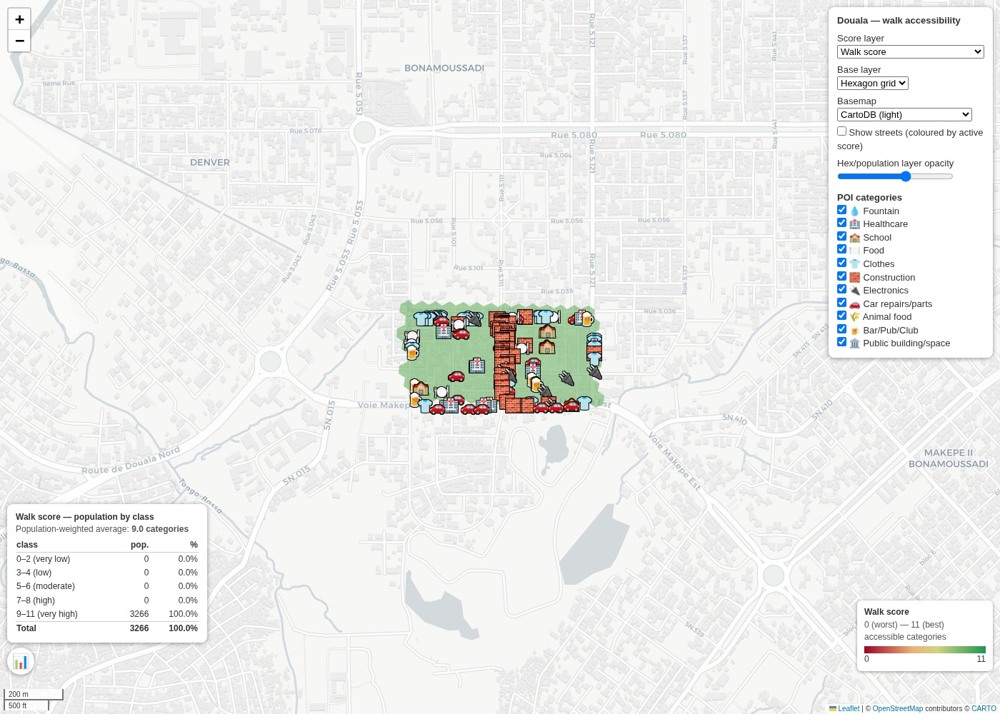
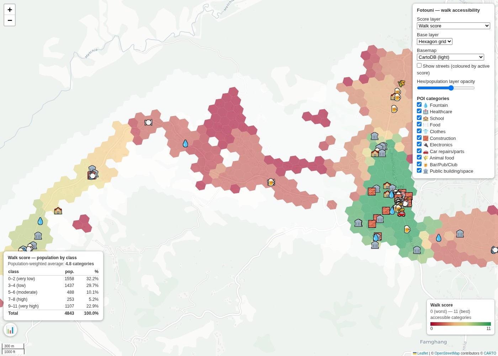

## Background

The 15-minute city concept argues that a well-functioning neighborhood should give every resident access to the essential categories of daily life within a short walk or bike ride from home, rather than requiring a car trip [1](#ref1). These categories are health, education, food, work, and leisure. This idea has been put into practice with concrete, network-distance-based accessibility measurements rather than a single composite score [2](#ref2), an approach this analysis follows closely. Walkability metrics are highly sensitive to whether distances are measured along the real street network or as a straight line [3](#ref3). For that reason, this analysis always uses actual street-network routing rather than Euclidean buffers.

Of every place visited in this broader research programme, Fotouni is arguably the closest realization of the 15-minute city ideal seen so far, likely as a result of low motorization and a dense, mixed-use pattern of small shops, workshops, and services embedded directly within residential areas. This section presents the methodology used to quantify that observation, and the pilot results for Fotouni and Douala.

## Methodology

Proximity is computed from the same building-level survey data used across this project. For each surveyed point, one coordinate is resolved by preferring the RTK fix whenever it is present.

Eleven categories of everyday destination are considered, each identified by a name and an emoji used consistently across the maps: fountain, healthcare, school, food, clothes, construction materials, electronics, car repairs or parts, animal feed, bar or pub or club, and public building or space. Membership in a category is derived automatically from the survey's own product tags for commercial, office, and industry rows, and from a regular expression over free-text land-use comments for public-service rows. A row can belong to more than one category. A combined restaurant and bar, for instance, counts as both food and bar or pub or club.

For every hexagon covering a pilot area, the real walking-network distance, not a straight line, to the nearest point of interest of each category is computed with a multi-source Dijkstra search over the OpenStreetMap pedestrian network downloaded for that area [4](#ref4). Two layers are then derived from these distances. A walk score gives equal weight to all eleven categories, following the count-based proximity index design of [5](#ref5), and counts how many categories have a point of interest within 800 meters, the standard walkable-distance threshold in the 15-minute-city literature [1](#ref1)[6](#ref6). A separate per-category distance layer is kept for each category individually, in real meters rather than compressed into a single score, so a user can inspect exactly how far the nearest school is from any point.

Each pilot area is covered with Uber's H3 hexagonal grid [6](#ref6). Grid resolution is chosen automatically from each area's own projected area, so the analysis adapts to different spatial scales while keeping an appropriate level of detail. Population estimates used to compute the final accessibility scores come from the global WorldPop dataset [7](#ref7), which combines remote sensing data, United Nations data, and national census sources into population estimates at roughly 100 meter resolution worldwide.

 the OSM pedestrian network, H3 hexagon grid, and categorized survey points. (b) multi-source Dijkstra network distance to the nearest school, one of eleven per-category layers. (c) the resulting composite walk score choropleth. (d) population-weighted percentage of the AOI reached within 800 meters, for every category, sorted most to least accessible.")

## Results

Every one of Bonamoussadi's 3,266 surveyed-area residents lives within an 800 meter walk of at least 9 of the 11 service categories, missing only government and animal feed. Eight of the eleven categories are within 800 meters of the entire population. Fotouni, a rural town center with its surrounding chieftaincies, shows a population-weighted walk score of 4.79 out of 11, with a markedly uneven spatial pattern. A green core sits around the town center and main chieftaincy, against a red periphery and access corridor reaching a walk score at or near 0 in the most isolated hexagons.

| | Bonamoussadi, Douala | Fotouni |
|---|---|---|
| Hexagons (approx. edge length) | 112 (approx. 27 m) | 944 (approx. 72 m) |
| AOI population (WorldPop) | 3,266 | 4,843 |
| Population-weighted walk score | 9.00 / 11 | 4.79 / 11 |
| Walk score range | 9 to 9 (uniform) | 0 to 11 |
| Within 800 m of school | 100% | 50.9% |
| Within 800 m of healthcare | 100% | 29.5% |
| Within 800 m of food | 100% | 61.9% |

The two pilot areas show two very different but both highly accessible settlement patterns. In Bonamoussadi, the surveyed blocks in Douala show an exceptionally high level of pedestrian accessibility. Within a small area, residents reach a wide range of essential services through a dense network of nearby shops and facilities. This is not only a matter of how many services exist, but of how closely they sit within the urban fabric, so daily needs can be met without a car.

Fotouni has a substantially lower walk score because of its rural character and more dispersed settlement pattern, yet its accessibility is still notable. Even without the dense commercial network found in Douala, the town center and surrounding chieftaincies give residents a level of local access that would be hard to reach in many car-dependent settlement models. These results show that highly accessible communities are not limited to dense urban environments. A well-structured rural settlement can also give residents meaningful access to essential services on foot, which is a useful planning lesson for more car-oriented regions, where similar ideas about proximity and mixed local services could help reduce transport dependence and improve everyday accessibility.

Beyond commercial accessibility, the Fotouni pilot area also shows the role local institutions and public services play in everyday accessibility. Traditional authorities through the chieftaincy system, together with fountains, government buildings, and schools, form a visible network of social and administrative infrastructure spread through the community. Where maintaining social cohesion and effective local governance can be hard, these physical points of presence help connect residents with essential services and institutions.

## References

1. Moreno, C., Allam, Z., Chabaud, D., Gall, C., Pratlong, F. (2021). Introducing the "15-Minute City": Sustainability, Resilience and Place Identity in Future Post-Pandemic Cities. Smart Cities, 4(1), 93-111. <a class="ref-link" href="https://doi.org/10.3390/smartcities4010006">https://doi.org/10.3390/smartcities4010006</a>
2. Weng, M., Ding, N., Li, J., Jin, X., Xiao, H., He, Z., Su, S. (2019). The 15-minute walkable neighborhoods: Measurement, social inequalities and implications for building healthy communities in urban China. Journal of Transport & Health, 13, 259-273. <a class="ref-link" href="https://doi.org/10.1016/j.jth.2019.05.005">https://doi.org/10.1016/j.jth.2019.05.005</a>
3. Dovey, K., Pafka, E. (2020). What is walkability? The urban DMA. Urban Studies, 57(1), 93-108. <a class="ref-link" href="https://doi.org/10.1177/0042098018819727">https://doi.org/10.1177/0042098018819727</a>
4. Hansen, W.G. (1959). How Accessibility Shapes Land Use. Journal of the American Institute of Planners, 25(2), 73-76. <a class="ref-link" href="https://doi.org/10.1080/01944365908978307">https://doi.org/10.1080/01944365908978307</a>
5. Gaglione, F., Gargiulo, C., Zucaro, F. (2024). Just Around the Corner: Accessibility by Proximity in the 15-Minute City. Journal of Urban Mobility, 6, 100084. <a class="ref-link" href="https://doi.org/10.1016/j.urbmob.2024.100084">https://doi.org/10.1016/j.urbmob.2024.100084</a>
6. npj Urban Sustainability (2023). Accessibility Inequality Across Europe: A Comparison of 15-Minute Pedestrian Accessibility in Cities with 100,000 or More Inhabitants. 3, 44. <a class="ref-link" href="https://doi.org/10.1038/s42949-023-00133-w">https://doi.org/10.1038/s42949-023-00133-w</a>
7. WorldPop (2020). WorldPop Open Population Repository. University of Southampton. <a class="ref-link" href="https://www.worldpop.org">https://www.worldpop.org</a>
